<a href="https://newportfoilo-tawny.vercel.app"></a>

  
  
  
  



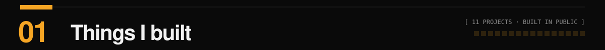

<a href="https://github.com/aasim-syed?tab=repositories">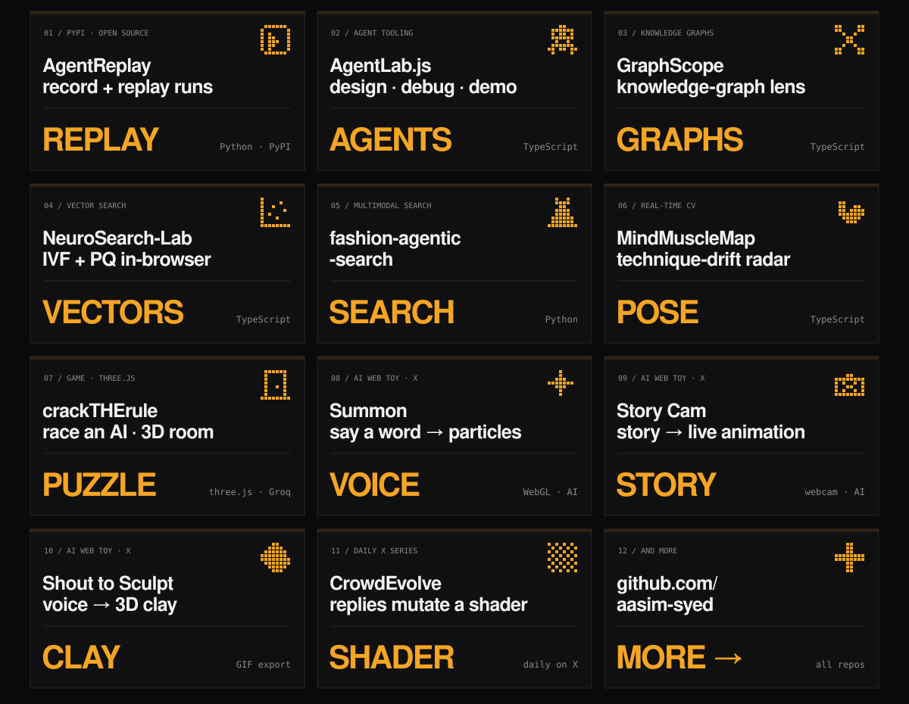</a>

<b>Links & details</b>

 

| Project | What it does |
|---|---|
| 🎞️ **AgentReplay** | Open-source PyPI package to record & replay LLM agent runs |
| 🧠 [**AgentLab.js**](https://github.com/aasim-syed/AgentLab.js) | Design. Debug. Demo. Agents, all in the browser |
| 🕸️ [**GraphScope**](https://github.com/aasim-syed/GraphScope) | Inspect knowledge graphs like a scientist |
| 🔍 [**NeuroSearch-Lab**](https://github.com/aasim-syed/NeuroSearch-Lab) | In-browser IVF + PQ vector search playground with benchmarks |
| 👗 [**fashion-agentic-search**](https://github.com/aasim-syed/fashion-agentic-search) | Agentic multimodal fashion search |
| 💪 [**MindMuscleMap**](https://github.com/aasim-syed/MindMuscleMap) | Detects and visualizes technique drift in real time |
| 🚪 **crackTHErule** | Race an AI to crack a secret rule — six switches, one door, a 3D escape room (Next.js + three.js + Groq) |
| ✨ **Summon** | Say a word, it appears as particles in your hands |
| 🎥 **Story Cam** | Tell a story out loud, watch it animate live over your webcam |
| 🗿 **Shout to Sculpt** | Your voice shapes a 3D clay blob — export as GIF |
| 🌀 **CrowdEvolve** | A living shader the top reply on X mutates every day |


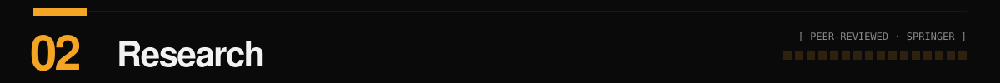

<a href="https://doi.org/10.1007/s11042-024-20187-x">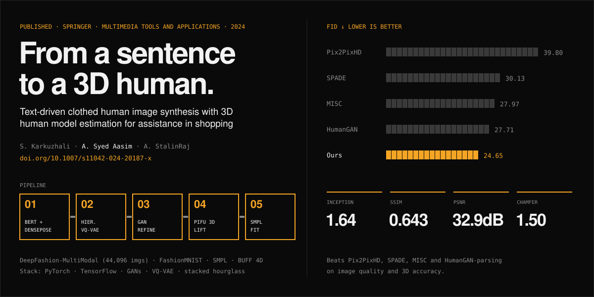</a>

> **Text-Driven Clothed Human Image Synthesis with 3D Human Model Estimation for Assistance in Shopping**
> S. Karkuzhali, **A. Syed Aasim**, A. StalinRaj · *Multimedia Tools and Applications*, Springer, 2024 · [DOI](https://doi.org/10.1007/s11042-024-20187-x)
>
> Type a description of an outfit, get a full-body photo of a person wearing it, then lift that photo into a 3D model so shoppers can see fit. BERT attribute encoding + DensePose → hierarchical VQ-VAE → GAN refinement → pixel-aligned implicit function (PIFu) + stacked hourglass → SMPL. **FID 24.65**, beating Pix2PixHD, SPADE, MISC and HumanGAN-parsing.

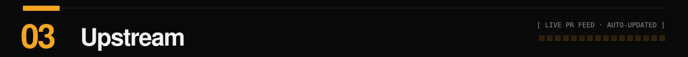

<a href="https://github.com/pulls?q=is%3Apr+author%3Aaasim-syed+-user%3Aaasim-syed"></a>

<b>All PRs (auto-updated daily)</b>

 

<!-- OSS:START -->
| | Repo | PR | |
|---|---|---|---|
| 🟧 merged | [traceloop/openllmetry](https://github.com/traceloop/openllmetry) ★7.5k | [fix(bedrock): trace invoke_model* calls whose body is a file-like object](https://github.com/traceloop/openllmetry/pull/4602) | 2026-10-11 |
| ⬜ in review | [NVIDIA/Model-Optimizer](https://github.com/NVIDIA/Model-Optimizer) ★5.5k | [[Puzzletron] Reuse existing subblock stats when resuming a run](https://github.com/NVIDIA/Model-Optimizer/pull/2555) | 2026-09-27 |
| ⬜ in review | [paperclipai/paperclip](https://github.com/paperclipai/paperclip) ★109.5k | [fix(cli): stop running npm against pnpm, Yarn, and Bun global installs](https://github.com/paperclipai/paperclip/pull/14126) | 2026-09-26 |
| 🟧 merged | [apache/shardingsphere](https://github.com/apache/shardingsphere) ★20.8k | [Update README.md](https://github.com/apache/shardingsphere/pull/15946) | 2022-03-09 |
| 🟧 merged | [apache/shardingsphere](https://github.com/apache/shardingsphere) ★20.8k | [Improving readme](https://github.com/apache/shardingsphere/pull/15898) | 2022-03-09 |
| 🟧 merged | [freeCodeCamp/how-to-contribute-to-open-source](https://github.com/freeCodeCamp/how-to-contribute-to-open-source) ★9.3k | [Update PROJECTS.md](https://github.com/freeCodeCamp/how-to-contribute-to-open-source/pull/580) | 2021-09-02 |
<!-- OSS:END -->

🎃 Hacktoberfest contributor · 🥇 GWOC '21 open-source contributor · 🌱 GirlScript mentor

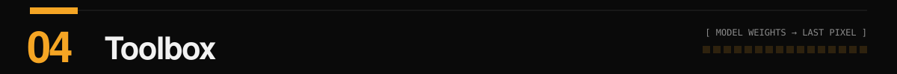

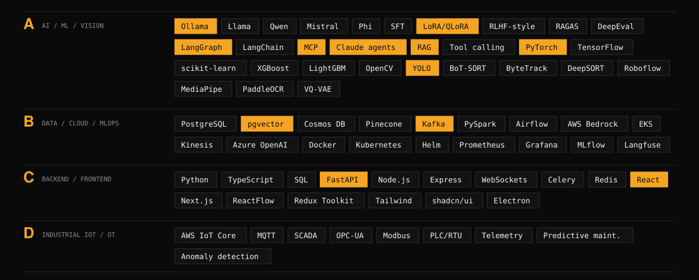

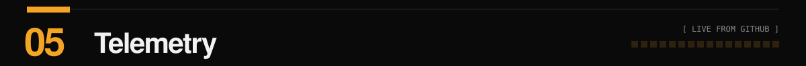

  
  

  

<b>🏆 Wins & community</b>

 

- 🧑‍💻 **3× hackathon winner** — Smart India Hackathon finalist · OpenForce 2022 Top 50
- 🌱 **Mentored 500+ students** — GirlScript Winter/Summer of Code 2021 & 2022
- 🎓 **B.E. Computer Science** — MEPCO Schlenk Engineering College, 2019–2023


<a href="mailto:syedaasim133@gmail.com"></a>

